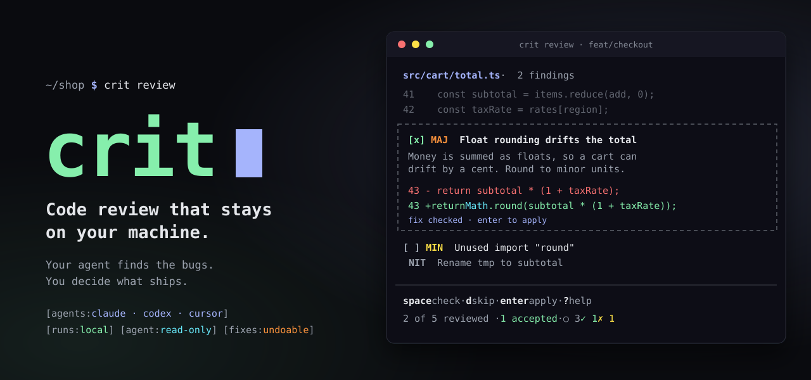

<div align="center">



<h3>AI code review that runs in your terminal, on your machine.</h3>

crit drives the agent CLI you already use (Claude Code, Codex or Cursor), collects its findings,
and shows them in an interactive full-screen UI. You pick what to keep, apply the fixes, and undo
them if you change your mind.


[Quick start](#quick-start) ·
[How it works](#how-it-works) ·
[Install](#install) ·
[Usage](#usage) ·
[Review screen](#the-review-screen) ·
[GitHub PRs](#github-pull-request-comments) ·
[Cost](#what-a-review-costs)

</div>

---

## Why crit

- **Local-first.** Nothing leaves your machine except what your agent CLI already sends. No crit
  server, no account, no API key of its own.
- **Bring your own agent.** Works with `claude`, `codex` or `cursor-agent`, using the login you
  already have.
- **You stay in control.** Every finding is a card you accept or dismiss. Fixes are applied only
  when you check them, and `crit undo` reverts them.
- **Read-only agents.** The agent can read code and report findings. Crit applies fixes itself,
  never the agent. See [Safety](#safety).
- **Cheap to re-run.** Unchanged files are answered from a cache at zero tokens, and a budget
  stops runaway reviews.
- **Fits your workflow.** Review a branch, staged changes, a commit, or a whole project, and post
  findings straight to a GitHub PR or export a report for CI.

## Quick start

```sh
# 1. install (macOS / Linux; on Windows see Install below. Needs Node 24+, git and a logged-in agent CLI)
git clone --depth 1 git@github.com:ihornovykov/crit.git && bash crit/scripts/install.sh

# 2. check that everything is ready
crit doctor

# 3. in any git repository, open the start screen and review
crit
```

The first review walks you through choosing a provider. Setup is explained in [Install](#install).

## How it works


1. **Scope.** Choose what to review: this branch against its base, staged changes, one commit,
   another branch or PR, specific paths, or the whole project.
2. **Review.** Crit splits the work into runs, skips noise (lockfiles, generated files,
   binaries) and has your agent review each one, optionally with a second "skeptic" pass that
   challenges each finding.
3. **Decide.** Walk through findings in the terminal UI. Check the fixes you want.
4. **Apply.** Press `enter`. Crit applies the checked fixes with `git apply`, keeps backups, and
   `crit undo` reverts them.

## Contents

- [Install](#install)
- [Usage](#usage)
- [The review screen](#the-review-screen)
- [GitHub pull request comments](#github-pull-request-comments)
- [Reviewing someone else's branch](#reviewing-someone-elses-branch)
- [What a review costs](#what-a-review-costs)
- [Providers and models](#providers-and-models)
- [Safety](#safety)
- [Configuration](#configuration)
- [Development](#development)

## Install

> **Distribution.** Version `1.1.0` is distributed internally and is not published to npm. The
> package name `@crit/cli` and the `$schema` URLs in the generated JSON schemas are placeholders
> until a final name is chosen.

### Requirements

| You need                                            | Why                                        |
| --------------------------------------------------- | ------------------------------------------ |
| Node 24+                                            | crit runs on Node's built-in `node:sqlite` |
| git                                                 | scopes, diffs and applying fixes           |
| One of `claude`, `codex`, `cursor-agent`, logged in | the agent that does the review             |

The GitHub CLI (`gh`) is **not** needed to install. It is only needed for [PR comments](#github-pull-request-comments).

### Install (macOS / Linux)

```sh
git clone --depth 1 git@github.com:ihornovykov/crit.git && bash crit/scripts/install.sh
```

The repository is private, so your GitHub account needs access to `ihornovykov/crit`. If you
authenticate over HTTPS instead of SSH, clone `https://github.com/ihornovykov/crit.git`. The
organization copy, `essensus-io/crit`, installs the same way.

Setup builds the CLI and puts the `crit` command in `~/.local/bin`, with no sudo and nothing
published to npm. pnpm is downloaded automatically at the version this repository pins. If setup
adds a directory to your shell's `PATH`, open a new terminal afterwards. Each person needs their
own logged-in agent CLI.

### Install (Windows)

Use PowerShell (Windows Terminal recommended):

```powershell
git clone --depth 1 git@github.com:ihornovykov/crit.git; powershell -NoProfile -ExecutionPolicy Bypass -File crit\scripts\install.ps1
```

Setup builds the CLI, installs it into `%LOCALAPPDATA%\crit` and adds that folder to your user
`PATH`. Open a new terminal afterwards. `CRIT_INSTALL_PREFIX`, `CRIT_INSTALL_REPO` and
`CRIT_INSTALL_REF` work the same as on macOS and Linux. Agent CLIs installed with npm (`.cmd`
shims) are supported, and `$EDITOR` defaults to `notepad`.

Then, from any repository:

```sh
crit doctor    # check the local setup
crit review    # connect a provider and open the review screen
```

### Update

From your crit checkout:

```sh
git pull --ff-only && pnpm install:cli
```

`pnpm install:cli` runs `scripts/install.sh` on macOS and Linux and `scripts\install.ps1` on Windows.

Updates keep your provider settings and review history. The installed app keeps working even if
you delete the checkout.

### Uninstall

```sh
npm uninstall --global --prefix "$HOME/.local" @crit/cli
```

Settings and history are kept.

<details>
<summary><b>Other ways to install</b></summary>

<br>

**Already have a checkout?** Run this from its root:

```sh
pnpm install:cli    # runs scripts/install.sh, or scripts\install.ps1 on Windows
```

**Sharing the installer.** You can hand someone `scripts/install.sh` on its own. Outside a
checkout it fetches the source into a temporary directory and removes it afterwards.

| Variable              | Default            | Does                                           |
| --------------------- | ------------------ | ---------------------------------------------- |
| `CRIT_INSTALL_REPO`   | `essensus-io/crit` | source repo, as `owner/repo` or a full Git URL |
| `CRIT_INSTALL_REF`    | `main`             | branch or tag to install                       |
| `CRIT_INSTALL_PREFIX` | `~/.local`         | installation directory                         |

```sh
CRIT_INSTALL_REPO=ihornovykov/crit bash install.sh
```

</details>

## Usage

Run `crit` with no arguments to open the **start screen**. Reviews never start by themselves.

### Common commands

| Command                       | What it does                                                                                       |
| ----------------------------- | -------------------------------------------------------------------------------------------------- |
| `crit`                        | start screen: pick what to review, see the cost, press `enter`                                     |
| `crit review`                 | same as above                                                                                      |
| `crit review --now`           | skip the start screen and review straight away                                                     |
| `crit review --staged`        | review staged changes                                                                              |
| `crit review --commit HEAD~1` | review one commit                                                                                  |
| `crit review --branch feat/x` | review another branch or a PR link, no checkout ([details](#reviewing-someone-elses-branch))       |
| `crit review src/billing`     | review paths, folders or globs (add `--diff` for changed files only)                               |
| `crit review --all`           | review the whole project (asks first)                                                              |
| `crit review --dry-run`       | show files, skipped files, runs and a token estimate, with no agent calls                          |
| `crit review --gh`            | review and post the findings to this branch's GitHub PR ([details](#github-pull-request-comments)) |
| `crit open`                   | reopen the latest saved review                                                                     |
| `crit apply` / `crit undo`    | apply all checked fixes / undo the last apply                                                      |
| `crit history`                | browse past reviews (`--compare a b`, `rm`, `prune --older-than 90d`)                              |
| `crit doctor`                 | check your setup and print config paths                                                            |
| `crit providers`              | list and manage provider profiles                                                                  |
| `crit rules`                  | list the rules crit reads (`crit rules add` adds one)                                              |
| `crit init`                   | create a project config at `.crit/config.json`                                                     |

### In CI

```sh
crit review --no-tui --format md --fail-on major
```

`--format` takes `json`, `md` or `sarif`. With `--fail-on major` crit exits with code `3` when it
finds anything at that severity or above.

### The start screen

Pick a scope (this branch against its base, staged changes, the last commit, the whole project, or
paths you type). You see how many files, runs and tokens it would cost, and `enter` starts it.

- Past reviews of the repository are listed on the right. Press `tab`, then `enter` to reopen one.
- `o` changes the provider, model, effort and depth.
- When a review finishes, `q` returns here, and `q` again quits.

## The review screen

The review is one scrolling stream. Each file with findings shows the code around them, with
changed lines marked `+` and syntax highlighting for TypeScript/JavaScript, Python, Go, Rust, Java,
Kotlin, Swift, Ruby, PHP, C/C++/C#, CSS, HTML, JSON, YAML, Markdown, SQL and shell. Each finding is a
card right under the lines it is about.

| Marker | Meaning   |
| ------ | --------- |
| `○`    | pending   |
| `✓`    | accepted  |
| `✗`    | dismissed |

The bottom line shows your progress ("2 of 5 reviewed · 1 accepted") and lists only the keys that
work right now. Press `?` for all of them.

It runs on the terminal's alternate screen, so your terminal's own scrollback is untouched and
comes back when you leave. Only the panels inside crit scroll.

### Keys you need first

| Key             | Does                                                                                   |
| --------------- | -------------------------------------------------------------------------------------- |
| `j` `k` `↑` `↓` | next / previous finding (the mouse wheel works too)                                    |
| `space`         | check the fix so it will be applied (again to uncheck). Unchecked fixes are left alone |
| `d`             | dismiss with a reason, remembered as a false positive (again to restore)               |
| `enter`         | apply every checked fix, once you have been through all findings                       |
| `?`             | help                                                                                   |
| `q`             | back to the start screen (quit when opened with `crit open`)                           |

<details>
<summary><b>All keys</b></summary>

<br>

| Key             | Does                                                                                                                            |
| --------------- | ------------------------------------------------------------------------------------------------------------------------------- |
| `j` `k` `↑` `↓` | next / previous finding (the mouse wheel too)                                                                                   |
| `space`         | check the fix to apply it (again to uncheck). Unchecked fixes are left alone                                                    |
| `d`             | skip: dismiss with a reason, remembered as a false positive (again to restore)                                                  |
| `enter`         | apply every checked fix, once you have been through all findings (it tells you if some were not looked at)                      |
| `i`             | propose your fix: tell the AI what it should be; it writes it in the background, then check it or not                           |
| `c`             | post this finding to this branch's GitHub PR as a comment, fix attached if it has one                                           |
| `x`             | apply just this fix now                                                                                                         |
| `r`             | re-run the review of this scope, reviewing every file again (no cache)                                                          |
| `PgUp` `PgDn`   | scroll the code                                                                                                                 |
| `/`             | search: words, `sev:major`, `lens:security`, `file:cart`, `has:fix`, `is:pending`, `is:filtered`                                |
| `.`             | actions: propose a fix, edit it in `$EDITOR`, ask a question, re-check the file, copy as a prompt, use my fix                   |
| `o`             | options: provider, model, reasoning effort, depth, save as default, rules on/off                                                |
| `y`             | copy the finding as a prompt for another agent                                                                                  |
| `tab` `]` `[`   | next / previous file (`h` `l` or the arrows switch between the files list and the code; in the list `j` `k` jump between files) |
| `g`             | first finding                                                                                                                   |
| `?` `q`         | help · back to the start screen (quit when opened with `crit open`)                                                             |

Model, provider, effort and depth apply to the _next_ ask, proposal or re-check. While a review
runs, `m` `P` `E` `D` `S` change the next run instead, and `r` retries with them. Finished files
are cached, so a retry only pays for what is left.

</details>

## GitHub pull request comments

Post findings to a pull request without leaving the terminal.

```sh
crit review --gh    # or --pr
```

This runs the review without the screen and posts every open finding as **one GitHub review with
inline comments** on the open pull request of your branch.

- **Single finding.** In the review screen, `c` posts the finding you are on. `enter` only applies
  the checked fixes locally.
- **Connect GitHub.** Press `o` then `g` on the start screen or in a review. It runs
  `gh auth login` for you.
- **Needs the GitHub CLI.** Install `gh` and log in with `gh auth login`.
- **Fails early.** Crit finds the PR before the review starts, so a missing PR costs no tokens.
- **Findings outside the PR diff** go in the review text instead of inline.
- **Re-runs are safe.** Findings that were already posted are skipped.
- **Fixes** are attached as `diff` blocks.

## Reviewing someone else's branch

```sh
crit review --branch <name-or-PR-link>
```

You can also choose **Another branch or PR…** on the start screen. Nothing is checked out: crit
diffs and reads the files straight from git, fetching the branch from `origin` if you don't have
it, and compares it with the base branch.

Fixes can't be applied to your working tree here, so `enter` and `x` refuse. Press `c` to post one
finding to that branch's PR, or add `--gh` to post them all.

## What a review costs

Crit counts **effective tokens** = fresh input + output + 0.1 × cached input. That is what
actually drives cost and rate limits.

| Control           | How it works                                                                                                                                                     |
| ----------------- | ---------------------------------------------------------------------------------------------------------------------------------------------------------------- |
| **Preview**       | `--dry-run` shows the plan and estimate first. Reviews above 500k estimated tokens ask before starting (`--yes` skips, `budget.confirmTokens` changes the limit) |
| **Hard stop**     | stops at `budget.maxTokens` (default 2M, or `--budget 500k`). The review ends as `partial`, keeps its findings, and a re-run resumes from the cache              |
| **Cache**         | unchanged files (same content, hunks, rules, lenses, provider, model) are answered at zero tokens, including skeptic verdicts                                    |
| **Skipped noise** | lockfiles, generated files, snapshots, binaries, fonts, Markdown/SVG and agent config. `--dry-run` lists what was skipped and why                                |
| **Base branch**   | the _nearest_ candidate (fewest commits ahead), so a branch cut from `develop` isn't compared with `main`                                                        |

Claude Code reports usage per message, so the budget stops it mid-run. Codex and Cursor report at
the end of a run, so they can overshoot by one run.

### Depth

`--depth quick | standard | deep`

|         | quick                 | standard (default)               | deep                      |
| ------- | --------------------- | -------------------------------- | ------------------------- |
| Lenses  | correctness, security | all, one pass                    | all, split                |
| Skeptic | off                   | critical/major/minor, fast model | every finding, main model |
| Effort  | low                   | profile                          | high                      |

## Providers and models

```sh
crit providers                                  # list profiles
crit providers add codex --model gpt-6-sol --effort low
crit providers models codex --search sol        # live model list from the CLI
crit review --model opus --effort high          # for one run
```

- Each profile can have a `fastModel` for cheap work (the skeptic and map steps).
- Models come from the CLI itself (`codex debug models`, `cursor-agent --list-models`), with a
  fallback list and **Other…** for any name.
- Only reasoning efforts the chosen model supports are offered.
- Codex runs with `--ignore-user-config`, so your `config.toml` model does not apply. Set one on
  the profile instead.

## Safety

Reviews are read-only by design. How that is enforced depends on the CLI:

| Provider    | Enforcement                                                                                                                                             |
| ----------- | ------------------------------------------------------------------------------------------------------------------------------------------------------- |
| Claude Code | Only the crit MCP tools plus read tools (`Read`, `Grep`, `Glob`). User settings, other MCP servers and plugins are off. The skeptic runs with no tools. |
| Codex       | `--sandbox read-only`, ephemeral session, user config ignored, plugins/apps disabled. Crit's MCP tools are pre-approved.                                |
| Cursor      | `--mode ask` (read-only). **Weaker:** Cursor has no per-run MCP, so findings come back as JSON on stdout and tool access is whatever ask mode allows.   |

Fixes are applied by crit itself (`git apply --check`, backups, `crit undo`), never by the agent.

## Configuration

| What                                   | Where                                                                                                                           |
| -------------------------------------- | ------------------------------------------------------------------------------------------------------------------------------- |
| User settings                          | `providers.json` and `config.json` in the crit config directory. `crit doctor` prints the paths, `CRIT_HOME` overrides them     |
| Project settings (optional, committed) | `.crit/config.json`, created by `crit init`                                                                                     |
| Rules                                  | read from `CLAUDE.md`, `AGENTS.md`, `.cursor/rules` and `.crit/rules`. `crit rules` lists them, `crit rules add` adds one       |
| Editor completion                      | JSON schemas for both config files ship in `schema/`                                                                            |
| Data                                   | a SQLite database (Drizzle ORM, migrations embedded) holds reviews, findings, shards and history. `crit history prune` trims it |

## Development

```sh
pnpm install
pnpm check && pnpm check-types && pnpm test   # lint/format, types, unit + e2e
pnpm test:coverage                            # thresholds enforced
CRIT_LIVE=1 pnpm test:live                    # real agent CLIs, opt-in, spends tokens
pnpm --filter @crit/store db:generate         # after editing the Drizzle schema
```

Monorepo (pnpm + Turborepo):

| Package     | Holds                              |
| ----------- | ---------------------------------- |
| `schema`    | Zod schemas                        |
| `store`     | Drizzle + `node:sqlite`            |
| `core`      | scope, rules, sharding, pipeline   |
| `providers` | agent adapters                     |
| `mcp`       | the findings MCP server            |
| `testkit`   | fake agent for tests               |
| `apps/cli`  | the `crit` command and terminal UI |

## License

MIT. See [LICENSE](LICENSE).
